# Malware Analysis Report: WannaCry Ransomware
### **Analyst:** Abdel Nour
### **Date:** 14 September 2026
### **Sample Type:** Portable Executable (32-bit x86)
### **Threat Classification:** Ransomware / Worm

<hr>

## 1. Executive Summary:
This report details the technical analysis of a WannaCry (WannaCrypt) ransomware binary. The sample is an unpacked 32-bit Windows Executable written in C++ that functions as both a file-encrypting ransomware and a self-propagating network worm.

During analysis, a prominent kill-switch mechanism was identified. Prior to executing its destructive payload or spreading across the network, the binary attempts an HTTP GET request to a hardcoded domain (hxxp://iuqerfsodp9ifjaposdfjhgosurijfaewrwergwea.com). If the domain resolves and returns a valid web response, the malware immediately terminates execution. If the request fails (i.e., the domain is unreachable), the malware installs itself as a service (mssecsvc2.0), scans local subnet IP ranges via SMB (Port 445) for lateral movement, and drops/executes file encryption routines.

## 2. High-Level File Identification & Hashes:
| Property | Value |
|:--------:|:-----:|
| Filename | WannaCry.exe |
| File Type | Win32 EXE (GUI) Intel 80386 / 32-bit x86 |
| MD5 | db349b97c37d22f5ea1d1841e3c89eb4 |
| SHA1 | e889544aff85ffaf8b0d0da705105dee7c97fe26 |
| SHA256 | 24d004a104d4d54034dbcffc2a4b19a11f39008a575aa614ea04703480b1022c |
| VirusTotal Detection Rate | 69/71 (Trojan.Wannacry / Ransomware / Worm) |
| Language / Compiler | Microsoft Visual C++ (MSVCP60.dll / MSVCRT.dll runtime) |
| Packing Status | Unpacked |

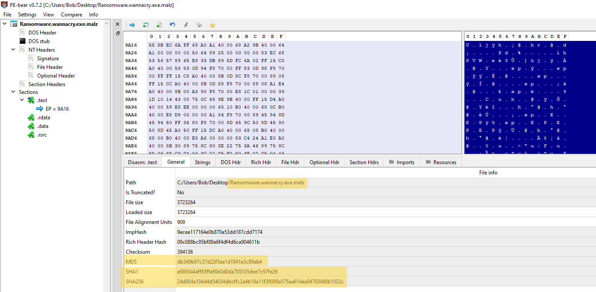
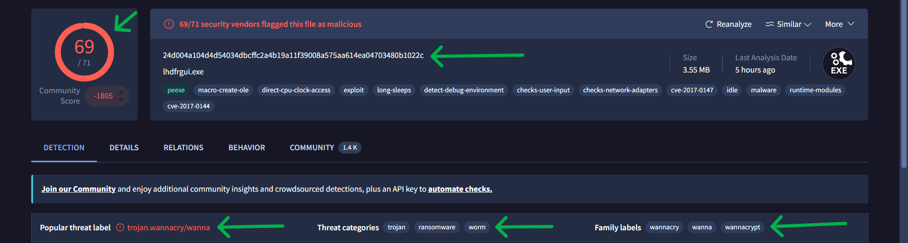

## 3. Basic Static Analysis:
### 3.1 Unpacking Verification:
Section header inspection confirms the binary is unpacked:
- Virtual Size and Raw Data Size across PE sections show close parity.
- Standard C++ runtime import address table (IAT) remain intact and fully visible.
- Cleartext ASCII/Unicode strings are readily observable without prior decryption passes.

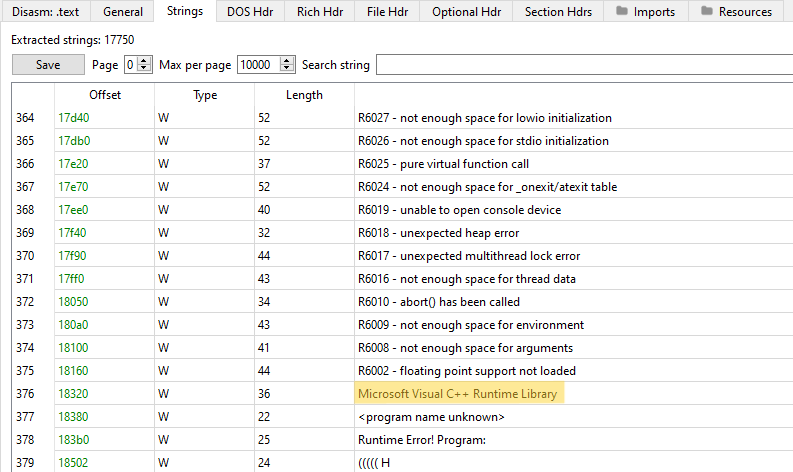
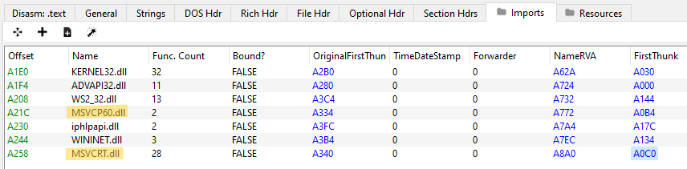
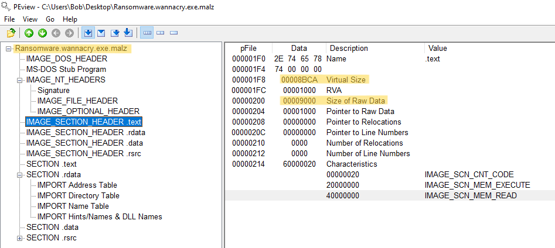

### 3.2 Import Address Table & Key API Capabilities:
Analysis of imported DLLs reveals four core operational capabilities:
1. **Network Discovery & Worm Propagation (iphlpapi.dll, ws2_32.dll):**
    - **GetAdaptersInfo / GetPerAdapterInfo:** Used to map local network interface cards (NICs), IP addresses, and subnets to establish target scanning ranges.
    - **WS2_32.dll raw socket calls:** Used to manage TCP socket connections to port 445 on discovered IPs.

2. **Kill-Switch Web Verification (wininet.dll):**
    - **InternetOpenA, InternetOpenUrlA, InternetCloseHandle:** Used to initialize HTTP sessions and request the kill-switch domain.

3. **Persistence & Service Management (advapi32.dll):**
    - **OpenSCManagerA, CreateServiceA, StartServiceA:** Used to register and launch the malware as a background service named mssecsvc2.0.
    - **StartServiceCtrlDispatcherA, RegisterServiceCtrlHandlerA:** Allows native interaction with the Windows Service Control Manager.

4. **Encryption Capabilities & Resource Extraction (advapi32.dll, kernel32.dll):**
    - **CryptAcquireContextA, CryptGenRandom:** Utilized to generate cryptographic key material for file encryption.
    - **FindResourceA, LoadResource, SizeofResource, LockResource:** Drops embedded payloads such as c.wnry, t.wnry, and localization archives.

## 4. Basic Dynamic Analysis:
### 4.1 Execution Context & Administrative Elevation:
- **Standard User Execution:** When launched without administrative privileges, the binary exits without encrypting files or creating persistent services.
- **Administrative Execution (Without Internet):** The process executes continuously for ~1 minute 20 seconds, altering file permissions, dropping secondary payloads (tasksche.exe, .wnry files), and encrypting user directories.

### 4.2 Network & Kill-Switch Behavior:
Dynamic testing under controlled network configurations confirmed the existence of an operational kill switch:
```
# FakeNet-NG Capture Logs (Domain Active)
09/09/26 01:57:58 PM [DNS Server] Received A request for domain 'www.iuqerfsodp9ifjaposdfjhgosurijfaewrwergwea.com'.
09/09/26 01:57:58 PM [HTTPListener80] GET / HTTP/1.1
09/09/26 01:57:58 PM [HTTPListener80] Host: www.iuqerfsodp9ifjaposdfjhgosurijfaewrwergwea.com
```
- **When FakeNet-NG is Active (Kill-Switch Triggered):** The malware sends a DNS request for hxxp://iuqerfsodp9ifjaposdfjhgosurijfaewrwergwea.com. Upon receiving a successful HTTP 200 OK response from the local listener, execution terminates immediately. No file encryption or SMB scanning occurs.
- **When Network is off (Kill-Switch Fails):** The DNS query fails. The malware immediately initiates lateral propagation scans on local /24 subnets over TCP port 445 under the service thread context mssecsvc2.0.


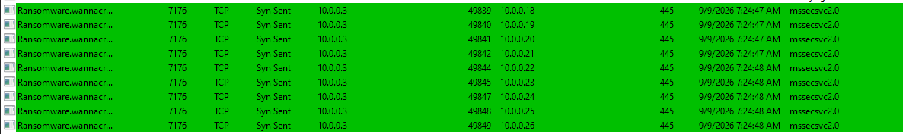
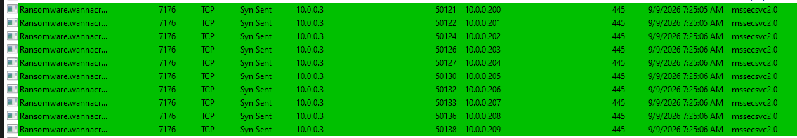

## 5. Advanced Reverse Engineering:
### 5.1 Disassembly Analysis of Main Entry Point:
Static disassembly in Cutter reveals the control flow logic governing the kill switch at the application entry point.

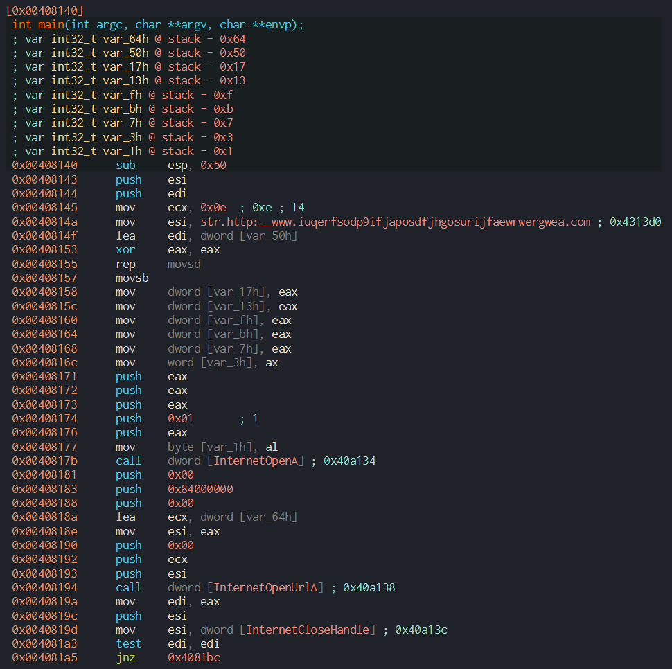
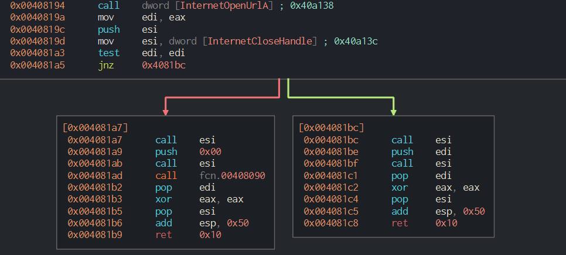

1. **String Loading:** The memory address of the kill-switch URL string is loaded into register ESI and copied onto the stack frame using rep movsd / movsb.
2. **API Invocation:** InternetOpenA is called with dwAccessType = 1 (INTERNET_OPEN_TYPE_DIRECT).
3. **HTTP Connection Attempt:** InternetOpenUrlA is invoked using the returned handle from InternetOpenA (EAX) and the target URL pointer (ECX). Flags are configured to 0x84000000 (INTERNET_FLAG_RELOAD | INTERNET_FLAG_NO_CACHE_WRITE).
4. **Branching:**
    - The return handle of InternetOpenUrlA stored in EAX is moved into EDI.
    - A test edi, edi instruction evaluates whether EDI holds a valid internet handle.
    - **If Valid (Non-Zero):** The Zero Flag (ZF) is set to 0. The conditional jump (jnz) takes the Green Branch, closing handles via InternetCloseHandle and exiting gracefully.
    - **If Invalid / Null (Zero):** The Zero Flag (ZF) is set to 1. The conditional jump fails, flowing into the Red Branch. InternetCloseHandle cleans up the session before transferring execution to the core payload initialization routine.

### 5.2 Dynamic Debugging & Branch Verification:
Live debugging in x32dbg validates the conditional execution paths under varying network conditions.

**Scenario A:** Unreachable Kill-Switch Domain (Live Infection Path)
When the domain does not resolve, InternetOpenUrlA returns 0x00000000 in EAX.

The subsequent test edi, edi sets ZF = 1. The conditional jump is not taken, forcing the binary to call the secondary payload initialization routine (mssecsvc2.0 service installer).

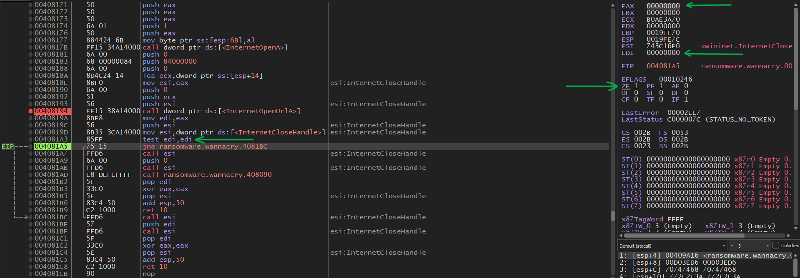
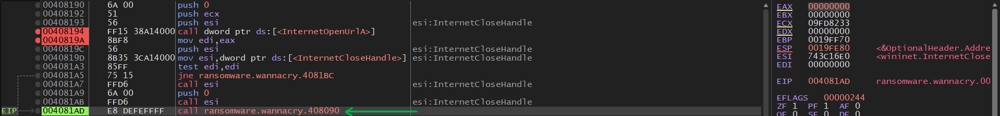

**Scenario B:** Simulating Active Domain via FakeNet-NG
When FakeNet-NG responds to the HTTP GET request, InternetOpenUrlA returns a valid handle (0x00CC000C).

The test edi, edi instruction sets ZF = 0. The jump condition is satisfied, causing the execution flow to bypass payload extraction entirely, close internet handles, and exit cleanly.

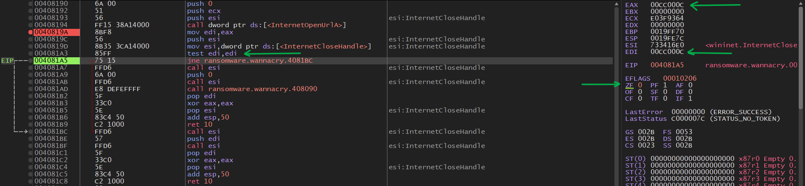
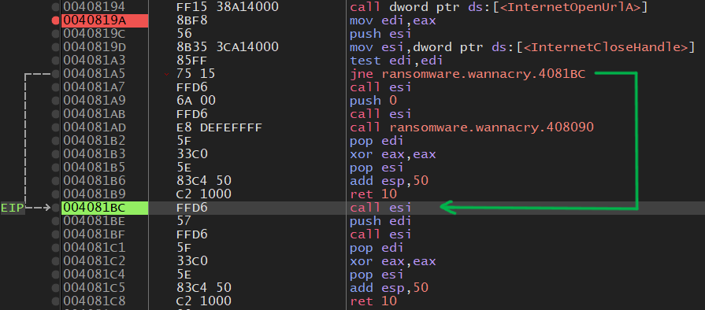

## 6. Indicators of Compromise (IoCs):
**Network Indicators:**
- **Kill-Switch URL:** hxxp://iuqerfsodp9ifjaposdfjhgosurijfaewrwergwea.com
- **Target Ports:** TCP 445 (SMB lateral movement scanning)

**Host Indicators:**
- **Service Name:** mssecsvc2.0
- **Scheduled Task File:** tasksche.exe
- **Dropped Extensions / Component Artifacts:** .wnry, c.wnry, t.wnry, u.wnry, WNcry@2017

**Executed Commands:**
```
icacls . /grant Everyone:F /T /C /Q
attrib +h
cmd.exe /c "%s"
```

## 7. YARA Detection Rule:
The following YARA rule detects unpacked variants of the WannaCry ransomware binary across disk and memory dumps by targeting the hardcoded kill-switch domain, service setup commands, and signature string artifacts identified during analysis:
```yar
rule Ransomware_Win32_WannaCry_Unpacked {
    meta:
        description = "Detects unpacked WannaCry ransomware based on kill-switch URL, service creation artifacts, and custom file extensions."
        author = "Abdel Nour"
        date = "2026-09-14"
        sample_md5 = "db349b97c37d22f5ea1d1841e3c89eb4"
        sample_sha256 = "24d004a104d4d54034dbcffc2a4b19a11f39008a575aa614ea04703480b1022c"
        threat_type = "Ransomware / Worm"

    strings:
        $s_killswitch = "iuqerfsodp9ifjaposdfjhgosurijfaewrwergwea.com" ascii wide

        // Service & Process Artifacts
        $s_service = "mssecsvc2.0" ascii wide
        $s_task    = "tasksche.exe" ascii wide
        $s_key     = "WNcry@2017" ascii wide

        // Payload Extensions
        $s_ext_c = "c.wnry" ascii wide
        $s_ext_t = "t.wnry" ascii wide
        $s_ext_u = "u.wnry" ascii wide

        // File Permission Reset Command
        $s_cmd = "icacls . /grant Everyone:F /T /C /Q" ascii wide

    condition:
        uint16(0) == 0x5A4D and 
        filesize < 10MB and
        (
            $s_killswitch or
            ($s_service and $s_key and $s_task and 2 of ($s_ext_*)) or
            ($s_cmd and $s_service)
        )
}
```